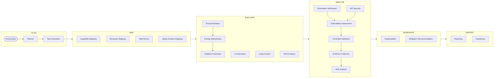

# AEGIS

**Autonomous Agentic AI Security Assessment & Adversarial Evaluation Platform**

AEGIS is a modular, explainable platform for continuous, **authorized** security
evaluation of **AI systems and web applications**. It combines AI red-teaming,
LLM behavioural evaluation, RAG assessment, agentic/MCP security, and web/API
VAPT into one closed-loop, multi-agent workflow that produces reproducible
evidence, standards-aligned findings, and defensive mitigation guidance.

It runs fully offline against a built-in deterministic mock, **and** against
**live targets** — a self-hosted LLM (vLLM / Ollama / any OpenAI-compatible
endpoint), a web app on localhost, or an authorized remote host on the internet —
orchestrating a controlled toolchain (Nmap, Nuclei, Katana, httpx, ffuf,
gobuster, feroxbuster, Arjun, Nikto, OWASP ZAP, sqlmap, ghauri) through a single
audited choke point.

> _AEGIS backronym: **A**daptive **E**valuation & **G**uarded **I**nspection **S**ystem._

```
objectives ─▶ PLAN ─▶ MAP ─▶ EVALUATE ─▶ ANALYZE ─▶ REMEDIATE ─▶ REPORT
               ▲ 25 agents + orchestrator · adaptive loop · audited tools ▲
```

---

## ⚖️ Authorized use only — this is a defensive tool

AEGIS assesses **systems you own or are explicitly authorized to assess.** That
is not a footnote; it is an **enforced, fail-closed runtime gate**
([`aegis/core/authorization.py`](aegis/core/authorization.py)) that every target
interaction — provider calls *and* external tools — must pass:

- Every request is checked against an **allow-list** of scope rules (hosts, URL
  globs, model ids, CIDRs), optionally time-boxed and volume-capped, each
  carrying an audit reference (signed SoW, ticket).
- **An empty scope authorizes nothing.** Out-of-scope requests never reach a
  provider or spawn a process — they are refused and recorded.
- A **remote** host is contacted only when (a) it is listed in the scope **and**
  (b) `scan.offline: false` is set. The default is offline (loopback only).
- Exploitation / credential / active-DAST tooling is gated behind explicit
  engagement switches (`exploitation`, `credential_testing`, `max_risk`) **and**
  a human approval callback, all default-off.

```bash
aegis scope-check examples/engagement-remote.yaml --url https://not-authorized.example.com
# URL https://not-authorized.example.com: DENIED — not covered by any active scope rule
```

---

## Quickstart

```bash
# 0. Use the bundled virtualenv (or create one) and install the package
python -m venv .venv && . .venv/bin/activate
pip install -e ".[extras]"          # extras adds: requests (live providers), yaml, jinja2

# 1. Fully-offline demo — mock target, no keys, no network
aegis demo                          # or:  python examples/run_demo.py

# 2. Inspect the collective, tools, and methodologies
aegis agents
aegis tools list
aegis integrations           # optional AI/ML libraries + whether each is installed
aegis methodology webapp

# 3. Offline accuracy benchmark (precision / recall / F1 on ground-truth fixtures)
aegis benchmark

# 4. Run a real engagement (edit the authorization scope first!)
aegis run examples/engagement-zap-dast.yaml --fail-on high
```

Run the tests (fully offline):

```bash
pytest -q            # 122 tests
```

---

## Running against live targets

AEGIS ships ready-to-edit engagement configs in [`examples/`](examples/). Every
one is fail-closed: only the hosts/URLs/models you list in `authorization` are
ever contacted. Set `scan.execute_tools: false` to **dry-run** (validate every
tool's argv and the scope decision without sending anything).

| Scenario | Config | What it does |
|----------|--------|--------------|
| Local web app (SPA-safe + exploitation) | [`engagement-zap-dast.yaml`](examples/engagement-zap-dast.yaml) | httpx + ZAP baseline + **paced ZAP active scan** + targeted sqlmap/ghauri against a localhost app |
| Local web app (full toolchain) | [`engagement-fulltools-exploit.yaml`](examples/engagement-fulltools-exploit.yaml) | the complete tool set; best for robust/multi-process targets |
| Recursive discovery | [`engagement-recursive.yaml`](examples/engagement-recursive.yaml) | katana/gobuster/ffuf discovery → recursive re-probe |
| **Live LLM (vLLM / Ollama)** | [`engagement-vllm-live.yaml`](examples/engagement-vllm-live.yaml) | AI red-team the **real model** via the `vllm` provider + httpx/nuclei on the endpoint |
| **Remote / internet target** | [`engagement-remote.yaml`](examples/engagement-remote.yaml) | `offline: false`; assess an **authorized** remote host |
| **Client pentest (web + API + model)** | [`engagement-client-pentest.yaml`](examples/engagement-client-pentest.yaml) | written-scope template: external toolchain + built-in **active-exploit confirmation** + **model red-team**, all gated to the SoW scope |

### Local web application

Point the config's `endpoint` at your localhost app (e.g. OWASP Juice Shop on
`http://127.0.0.1:3000`) and run:

```bash
aegis run examples/engagement-zap-dast.yaml
```

The built-in stdlib crawler reviews security headers and probes sensitive paths;
the external tools (httpx, nuclei, ZAP, sqlmap, …) run through the scope-gated
executor; findings flow into the report. *Note:* a single-process target (dev-mode
Node, Flask, …) can be overwhelmed by the full toolchain — prefer the `zap-dast`
config (paced, no request-flooders) for fragile targets.

### Live LLM served by vLLM / Ollama

AEGIS assesses a **real model** through any OpenAI-compatible endpoint. Set the
provider to `vllm` (alias for the OpenAI-compatible provider) and point it at your
server:

```yaml
targets:
  - id: "local-llm"
    kind: "ai_gateway"
    provider: "vllm"                       # -> OpenAICompatProvider
    endpoint: "http://127.0.0.1:8000/v1"   # vLLM; use :11434/v1 for Ollama
    model: "<served-model-id>"
    params: { max_tokens: 256, temperature: 0 }
```

```bash
# vLLM:  python -m vllm.entrypoints.openai.api_server --model <hf-model> --port 8000
export AEGIS_API_KEY=...          # only if your gateway requires a bearer token
aegis run examples/engagement-vllm-live.yaml
```

The AI red-team agents send real `/v1/chat/completions` probes and measure
instruction-following, response stability, calibration, long-context retention,
etc., while nuclei/httpx scan the inference server's HTTP surface — one engagement,
both dimensions.

### Remote / internet target

Edit [`engagement-remote.yaml`](examples/engagement-remote.yaml): put **your
authorized** host(s) in `authorization.rules`, record the `authorization_ref`,
and keep `scan.offline: false`. Start recon-only; escalate `max_risk` /
`exploitation` only within your written authorization.

```bash
aegis run examples/engagement-remote.yaml
```

### Exploitation mode

sqlmap, ghauri, and the ZAP **active** scan (`zap-full`) are DANGEROUS/INTRUSIVE
and stay refused until the engagement opts in:

```yaml
scan:
  exploitation: true        # unlocks sqlmap / ghauri / zap-full
  max_risk: "dangerous"     # raise the runnable-risk ceiling
  injection_targets:        # targeted, no-flood SQLi confirmation
    - url: "http://127.0.0.1:3000/rest/products/search?q=test"
```

Defaults are **detection/confirmation only** — no data-exfiltration (`--dump`)
or OS-takeover (`--os-shell`) flags.

### Built-in active web-exploit confirmation (no external binary)

The `web_exploit` agent confirms common web bugs itself — **reflected XSS, path
traversal / LFI, open redirect**, and (with a collaborator) **SSRF** — using
unique *benign* canaries. It is fail-closed and opt-in:

```yaml
scan:
  enabled: true
  active_exploit: true        # unlocks the built-in confirmation probes
  oob_host: null              # set to a host you control to enable SSRF checks
```

Every request is scope-gated, redirects are never followed, and the payloads
prove a bug exists without weaponizing it (reflected breakout characters, a
read of a benign system file, an unroutable `.invalid` redirect marker) — no
exfiltration, state change, or code execution. A correctly-encoding/validating
app is **not** flagged.

### Adversarial model red-team (authorized LLM testing)

The `adversarial_redteam` agent tests whether an authorized model is susceptible
to **prompt injection** (instruction-in-data override, OWASP LLM01),
**system-prompt / secret leakage** (LLM07), and **RAG query injection**. Success
is measured by a unique benign canary echoing back — never by generating harmful
content — so a secure model simply reports no susceptibility.

```yaml
redteam:
  enabled: true
  trials: 5                   # repeats per attack (gives a rate + confidence)
```

Both agents stay gated **off** by default; findings carry reproduction-grade
evidence and flow through the normal validation → risk → report pipeline with
OWASP/MITRE/NIST mappings and mitigations attached.

---

## Controlled external-tool integration

AEGIS orchestrates external tooling but **the language model never authors a
command line.** Every tool passes through one controlled, auditable choke point
([`ToolExecutor`](aegis/tools/execution.py)) with a standardized adapter
contract, so "AI + Kali tools" becomes safe by construction. For **every** run it
enforces, in order: tool known & executable → **fail-closed scope validation** →
offline/remote policy → risk/engagement-switch gating → **no-shell argv** built
from typed params → human-approval gate for ACTIVE+ tools → bounded execution
(timeout, captured output) → an **immutable audit record** (`tool_runs`) for
allowed, refused, and errored attempts alike. The default mode is **dry-run**.

| Tool | Category | Risk | Notes |
|------|----------|------|-------|
| subfinder | recon | passive | subdomain enumeration |
| nmap | network | active | service/version detection (bare host) |
| httpx, whatweb | fingerprint | safe | tech detection |
| katana | web-enum | active | JS-aware crawler (crawl-time bounded) |
| gobuster, ffuf, feroxbuster | web-enum | active | content discovery (SecLists wordlist) |
| arjun | web-enum | active | HTTP parameter discovery |
| nuclei | web-scan | active | template signature scan |
| nikto | web-scan | active | server misconfiguration scan |
| zap | web-scan | active | **ZAP baseline** (spider + passive) |
| zap-full | web-scan | intrusive | **ZAP active DAST** (paced; injection/XSS) |
| semgrep, gitleaks, trivy | static/container | safe | local source / image posture |
| sqlmap, ghauri | exploitation | dangerous | SQLi confirmation (gated) |
| garak, promptfoo | ai-redteam | active | LLM vuln/jailbreak/injection scanning of an authorized model |
| modelscan | static-analysis | safe | model-artifact supply-chain scan (unsafe pickle/deserialization) |
| metasploit, hydra, netron | exploitation/credential/viewer | — | documentation-only contracts |

```bash
aegis tools list
aegis tools select --kind rest_api --signals http,web,api,host --exploitation
```

ZAP runs **headless and Docker-free** via a user-space wrapper
([`scripts/zap_scan.py`](scripts/zap_scan.py)); see **Installation** below. See
[`docs/TOOL_INTEGRATION.md`](docs/TOOL_INTEGRATION.md) for the adapter contract.

### AI / ML tool integrations

AEGIS integrates best-of-breed AI/ML security tooling in two ways, matching how
each tool actually runs:

**CLI tools — through the same audited `ToolExecutor`** (scope + approval +
`tool_runs` audit, no-shell argv). Install the binary and it becomes selectable:

- **garak** (`pip install garak`) — LLM vulnerability scanner (jailbreak,
  prompt-injection, toxicity, leakage) against an authorized model endpoint.
- **promptfoo** (`npm i -g promptfoo`) — LLM red-team / eval harness.
- **modelscan** (`pip install modelscan`) — scans a model artifact for unsafe
  code / deserialization payloads **before** you load it (supply-chain).
- **netron** (`pip install netron`) — model architecture viewer; documentation-only
  (a manual GUI, not an automated scanner), paired with modelscan.

**Python libraries — runtime-detected, graceful fallback** (via
[`aegis.integrations`](aegis/integrations/)). These run in-process on a model or
dataset **you supply**, so they are invoked explicitly, never auto-run. When a
library is absent, the integration returns an install hint instead of failing:

```bash
aegis integrations            # list each library + whether it's installed
pip install -e ".[integrations]"
```

| Library | Domain | Assesses |
|---------|--------|----------|
| giskard | llm | model+dataset vuln scan (bias, robustness, injection, harm) |
| ragas | rag | faithfulness, answer relevancy, context precision/recall |
| ART (adversarial-robustness-toolbox) | adversarial-ml | evasion/poisoning attacks on a classifier |
| cleverhans | adversarial-ml | adversarial-example generation (FGSM/PGD) |
| deepteam | llm | attack-vulnerability red-teaming on a model callback |

---

## Installation

**Core** has zero hard dependencies and runs the full offline pipeline. Live
targets and external tools need a few extras:

```bash
pip install -e ".[extras]"          # requests (live LLM provider), pyyaml, jinja2
```

**External tools** — install the binaries you want on `PATH` (any that are
missing are skipped and recorded in the audit trail). Prebuilt release binaries
work without root:

```bash
# ProjectDiscovery / Go tools, feroxbuster -> ~/.local/bin (download release zips)
# Python tools:
pip install --user arjun
pip install --user git+https://github.com/r0oth3x49/ghauri.git
git clone --depth 1 https://github.com/sqlmapproject/sqlmap  ~/.local/opt/sqlmap   # wrap as 'sqlmap'
git clone --depth 1 https://github.com/sullo/nikto           ~/.local/opt/nikto    # wrap as 'nikto'
# Wordlist (SecLists), e.g. ~/.local/share/wordlists/common.txt (auto-detected)
```

**OWASP ZAP** (headless, user-space, needs Java 17+):

```bash
# download ZAP_x.y.z_Linux.tar.gz to ~/.local/opt/zap, then install the wrappers:
cp scripts/zap_scan.py ~/.local/bin/zap-baseline.py
cp scripts/zap_scan.py ~/.local/bin/zap-full-scan.py
chmod +x ~/.local/bin/zap-*.py
# seed the active scan with real endpoints (SPAs defeat the spider):
export ZAP_SEED_URLS="http://127.0.0.1:3000/rest/products/search?q=test,..."
```

Optional backends (all graceful-fallback): `pip install -e ".[graph]"` (LangGraph),
`".[explain]"` (TransformerLens/SHAP/Captum), `".[observability]"` (OpenTelemetry).

---

## The agent collective

Twenty-five specialized, collaborating agents over a shared blackboard state,
coordinated by an orchestrator, each with declared responsibilities,
inputs/outputs, confidence estimation, and stopping conditions. Two of them are
offensive (active web-exploit confirmation and model red-teaming) and stay gated
off unless the engagement explicitly enables them.



The **web_recon** agent drives the live crawler + external tools; the
**api_security** agent turns tool observations (nuclei signatures, nikto issues,
ZAP alerts, sqlmap/ghauri confirmations) and crawl results into candidate
findings; **risk_analysis** finalises severity with cross-domain correlation. See
[`docs/ARCHITECTURE.md`](docs/ARCHITECTURE.md) for each agent's contract.

---

## What it assesses

- **AI behavioural dimensions** (black-box, provider-agnostic): instruction
  following, reasoning consistency, response stability, robustness to formatting,
  long-context retention, confidence calibration, multilingual behaviour,
  structured output, grounding, context management.
- **Prompt mutation framework** — 20 semantics-preserving transforms (Unicode
  normalization, homoglyphs, bidi, zero-width, nested docs, re-serialization,
  framing, instruction-hierarchy, …). Deterministic and reproducible.
- **RAG pipelines** — grounding rate, unsupported-citation detection, retrieval
  quality, source attribution.
- **Agentic / MCP surfaces** — dangerous tools callable without confirmation,
  unauthenticated transports, excessive agency.
- **Web / API surfaces** — unauthenticated AI/inference endpoints, missing rate
  limits, unauthenticated state-changing endpoints, BOLA/BFLA-prone patterns,
  plus live-tool findings (injection, XSS, misconfig, exposure).
- **Cross-domain correlation** — a behavioural weakness on an *exposed* AI/agent
  surface is automatically elevated.

---

## Testing methodologies

A machine-readable, framework-mapped methodology knowledge base
([`aegis/methodology/`](aegis/methodology/)) — queryable via `aegis methodology`
and appended to every report.

| Methodology | Aligned to | Doc |
|-------------|-----------|-----|
| **Web Application & API** | OWASP WSTG v4.2, Top 10, API Top 10, ASVS, PTES, ATT&CK | [METHODOLOGY_WEBAPP](docs/METHODOLOGY_WEBAPP.md) |
| **Active Directory** | MITRE ATT&CK, MS tiering, CISA, NIST 800-53 | [METHODOLOGY_ACTIVE_DIRECTORY](docs/METHODOLOGY_ACTIVE_DIRECTORY.md) |
| **AI / LLM / Agentic Red-Teaming** | OWASP LLM Top 10, OWASP Agentic (ASI), MITRE ATLAS, NIST AI RMF | [METHODOLOGY_AI_REDTEAM](docs/METHODOLOGY_AI_REDTEAM.md) |

---

## Accuracy benchmark & the adaptive loop

`aegis benchmark` runs the detection engine against self-contained fixtures with
**known ground truth** and reports precision / recall / F1 — with hardened control
cases and honestly-reported coverage gaps. See [docs/BENCHMARK.md](docs/BENCHMARK.md).

The adaptive loop grows its probe pool each round, re-analyses the full pool so
confidence rises, and biases follow-ups toward under-covered dimensions —
weighted by historical priors from memory. Per-probe scoring is fixed, so
adaptivity never compromises reproducibility.

---

## Project layout

```
aegis/
  core/          types · config · authorization gate · events · confidence · memory
  providers/     mock (offline) · openai_compat (vLLM/Ollama/gateways, "vllm" key)
  targets/       LLM · RAG · Web/API · MCP adapters · live stdlib HTTP prober
  tools/         adapter spec · catalog · registry (selection) · controlled executor
  methodology/   framework-mapped web-app · Active Directory · AI red-team
  benchmark/     offline accuracy benchmark (ground-truth fixtures + scoring)
  mutation/      transform library + reproducible engine
  evaluation/    metrics · behavioral/long-context/RAG analyzers · adaptive loop
  agents/        25 agents + rule-based adjudication (incl. offensive, gated)
  graph/         shared state · orchestrator + phase state machine (LangGraph-optional)
  explainability/behavioral (always) · internals (TransformerLens/SHAP/Captum, optional)
  reporting/     framework mappings · report model · MD/HTML/JSON renderers
  observability/ structured logging · tracing (OpenTelemetry-optional)
  storage/       SQLite schema + persistence (probes, results, evidence, tool_runs)
  cli.py         run · demo · mutate · scope-check · agents · methodology · benchmark · tools
scripts/         zap_scan.py (headless ZAP wrapper) · benchmark/poc helpers
examples/        engagement configs (local web · recursive · ZAP · vLLM · remote) · run_demo.py
docs/            architecture, workflow, MCP, database, deployment, methodologies, tool integration
tests/           93 offline tests
```

---

## CLI

```
aegis run <config.yaml> [--fail-on low|medium|high|critical] [--workdir DIR] [--quiet]
aegis demo [--rounds N]
aegis scope-check <config.yaml> [--url URL] [--model ID]
aegis tools {list|select --kind K --signals a,b,c [--exploitation]}
aegis methodology [webapp|active-directory|ai-redteam] [--json|--export]
aegis mutate "<text>" [--count N] [--seed S]
aegis benchmark [--json]
aegis agents
```

---

## License

MIT — see [LICENSE](LICENSE). Use only against systems you own or are explicitly
authorized to assess.
